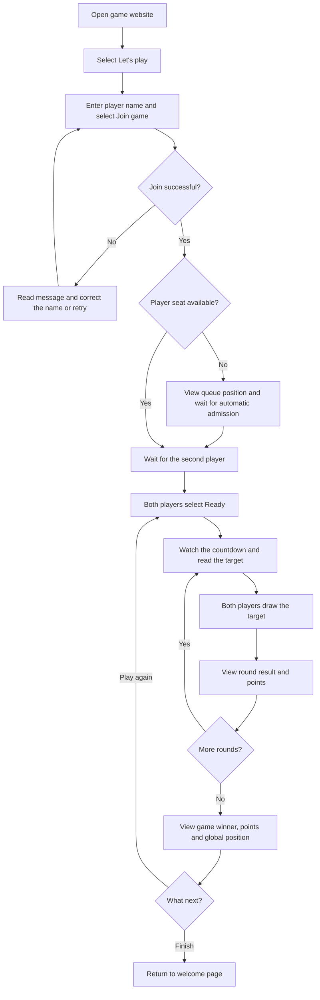
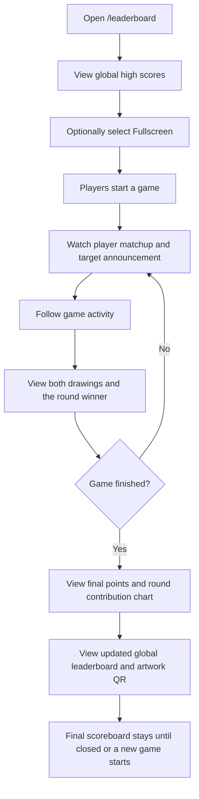
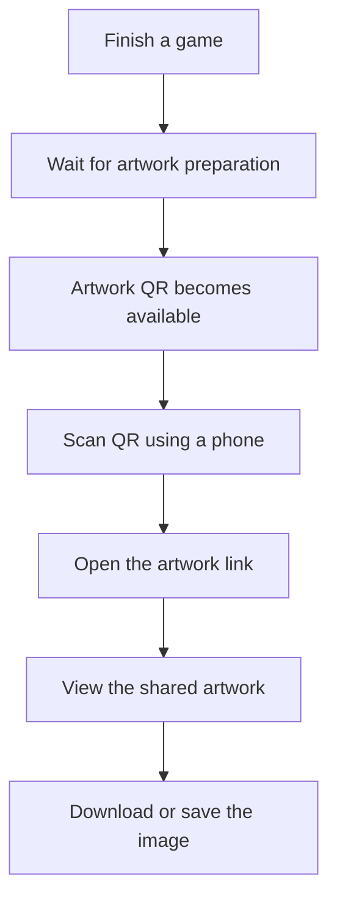
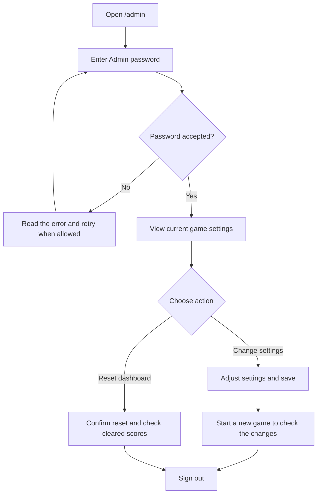
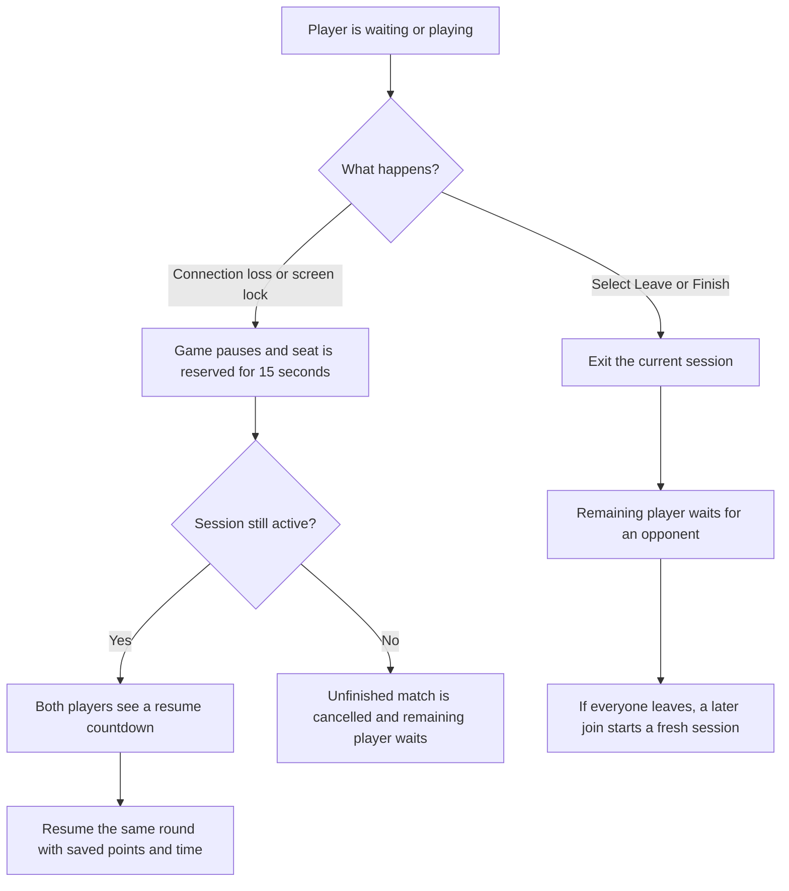

# TEDx Pictionary — High-Level User Flows

This document describes how players, spectators and administrators use the system.
Use these flows for a high-level walkthrough and QA testing. The diagrams use
Mermaid and can be viewed in a Markdown viewer with Mermaid support.

## Before testing

- Open the game on two separate devices or browser profiles.
- Use two different player names.
- Open `/leaderboard` on a separate display to watch the game.
- Have the Admin password available for `/admin` testing.
- Use the configured round duration shown during gameplay.

## 1. Join and play a game

**Check:** Both players join the same game, see the same target and progress
through the rounds together. A recognized drawing or an expired round timer
leads to a result. The final screen identifies a win, loss or tie correctly.
The losing player's screen shows their own points as well as the winning points.

## 2. Follow a game on the leaderboard display

**Check:** The display reflects the active game and highlights each round winner.
Both players' submitted drawings are shown when available. Each username has one
global leaderboard entry showing its best single-game score, rather than the sum
of all games. Returning players keep their assigned emoji.

## 3. Get the game artwork

**Check:** The QR opens a public address reachable from the phone. The artwork
uses both players' received drawings and includes branding, player names and
emojis. Blank canvases should not appear as filled black blocks. Artwork loading
should finish or show a useful error instead of leaving an endless spinner.

## 4. Manage the game as an administrator

**Check:** Settings require a valid Admin login. Saved settings apply to newly
created games. Reset clears leaderboard scores while retaining player emojis;
active games can continue. Signing out returns to the login screen.

## 5. Handle connection loss or leaving

**Check:** Refreshing or reconnecting must not create a second seat for the same
active player. A username already in use cannot occupy both seats. An unavailable
backend produces connection feedback and a retry path; successful connectivity
removes the connection notice.

## High-level QA completion checklist

- [ ] Two players can join, ready up and complete a game.
- [ ] Both players receive matching targets and round transitions.
- [ ] Recognition and timeout paths both finish rounds correctly.
- [ ] Winner, points and global positions are displayed correctly.
- [ ] Leaderboard activity shows both drawings when submitted.
- [ ] Reusing a name retains its emoji and only its best global score.
- [ ] QR works on a phone and the artwork can be saved.
- [ ] Play again and Finish follow the correct paths.
- [ ] Leaving, refreshing and reconnecting do not create duplicate players.
- [ ] Admin login, settings, dashboard reset and logout work as expected.
